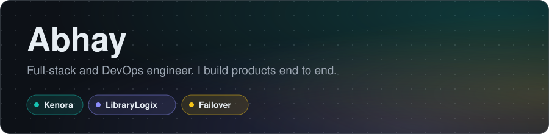
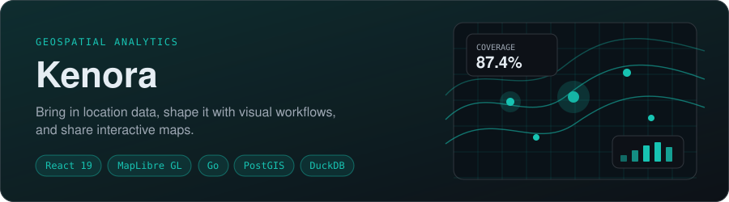
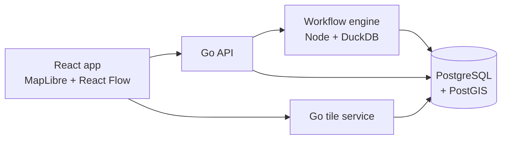
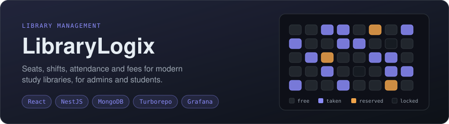
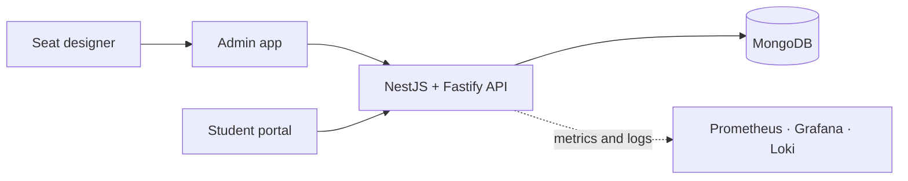
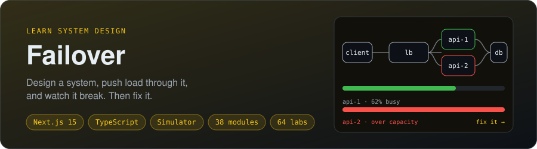

 

&nbsp;

&nbsp;

 

I design, build and run software end to end: React front ends, TypeScript, Go and Node back ends, the data underneath, and the infrastructure and monitoring it all runs on. These are the products I'm running.

---

## Products

**ValueDefine** is a geospatial analytics platform. Bring your data in, shape it with visual workflows, build interactive maps with widgets, and share them by link.

- **Visual workflows.** A node editor on top of a DuckDB workflow engine turns raw datasets into map-ready layers.
- **Interactive maps.** Vector tiles, widgets and shareable links.
- **Market Insights.** Describe your datasets, pick levels and measures, and get KPI cards, rankings, trends and tiles.
- **Built with** React 19, TypeScript, Vite, MapLibre GL, React Flow and TanStack Query on the front; a Go API and tile service plus a Node/TypeScript workflow engine behind it; PostgreSQL with PostGIS for data.

**[Open ValueDefine](https://valuedefine.com/login)** (sign-in required)

How it fits together

 

**LibraryLogix** replaces paper registers and guesswork in study libraries with one system for seats, shifts, attendance and fees, for the people who run the library and the students who use it.

- **Admin dashboard.** Student profiles, morning, evening and full-day shifts, fee status and renewals, and live attendance.
- **Seat designer.** Draw a library floor plan with drag and drop, then see every seat as free, taken, reserved or locked.
- **Student portal.** Students check their attendance, assigned seat and fee status, and request a seat for an admin to approve.
- **Built with** a Turborepo monorepo (admin app, seat designer, shared auth) in React 18, Vite, Tailwind CSS 4, Radix and shadcn/ui, Redux Toolkit and Recharts; a NestJS and Fastify API on MongoDB with Swagger docs, JWT auth, Docker and Nginx, and Prometheus, Grafana and Loki for monitoring.

**[Open the admin app](https://library-logix-frontend-react-admin.vercel.app/)**

How it fits together

 

**Failover** teaches system design by letting you build the system and then break it. You drag servers, caches, queues and databases onto a canvas, push load through the design, and watch which part gives way.

- **Content.** 38 modules and 256 lessons, from "what is system design" to replication, partitioning and global availability.
- **Hands-on labs.** 64 labs across classic systems (chat, feeds, ride hailing, payments) and cloud designs, each with an API step, a data-model step, rising load, a monthly budget and incidents such as a lost node or a cold cache.
- **A simulator you can trust.** A deterministic capacity and cost model with 33 component types. Every lab's reference answer is proven solvable by the same engine, and 560+ automated tests keep it honest.
- **AI systems track.** 14 modules and 18 labs on LLM gateways, retrieval, agents, evaluation, safety and serving models at scale.
- **Built with** Next.js 15, React 19, TypeScript, Tailwind CSS 4 and Zod, deployed on Vercel. Progress is saved in your browser, so there is nothing to sign up for.

**[Open Failover](https://failover.vikalpshorthand.com/)**

 

---

## More I've built

| Project | What it is |
| --- | --- |
| [**Car Fight**](https://github.com/abhay112/Cubicle_Crash) | A local multiplayer car battle game. Every player's webcam photo goes on the roof of their car, then everyone fights in one arena with random power-ups. |
| [**Content Aggregator**](https://github.com/abhay112/content-aggregator-backend-service) · [demo](https://content-aggregator-frontend-azure.vercel.app) | A Node, Express and TypeScript service that pulls technical content from Hacker News, Dev.to, Reddit and Lobsters into one searchable feed, refreshed by background jobs. |
| [**React Performance Demos**](https://github.com/abhay112/performanceTechniques) · [demo](https://performance-techniques.vercel.app) | Seven interactive demos of real React performance problems: how to spot each one, measure it and fix it. |
| [**Centralized Monitoring Stack**](https://github.com/abhay112/centralizedMonitoring) | A Dockerized Prometheus, Loki and Grafana stack that watches several PM2 and Docker services from one place. |
| [**MERN on Kubernetes**](https://github.com/abhay112/mern-docker) | A full-stack CRUD app (Next.js, Express, MongoDB) packaged with Docker and run on Kubernetes. |

---

## Toolbox

---

&nbsp;&nbsp;

